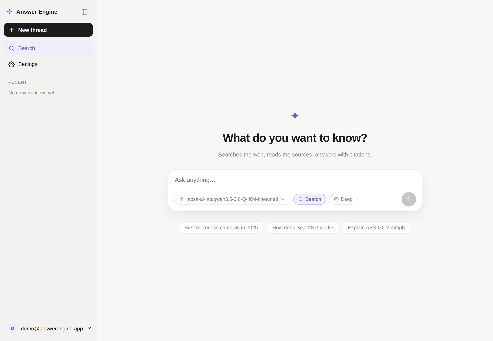
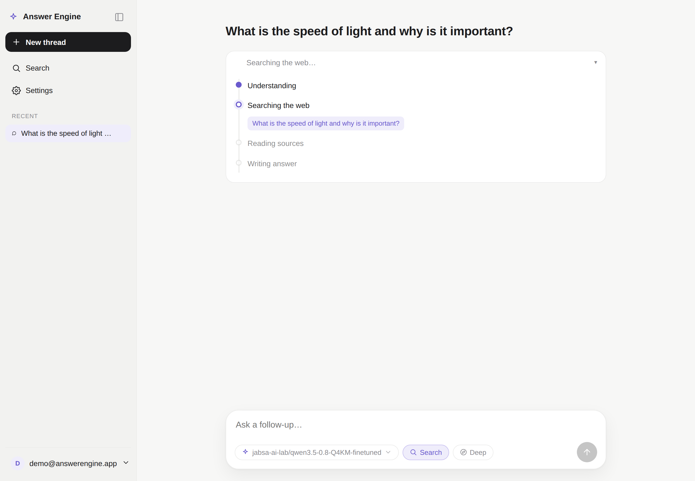

# Answer Engine

A small Perplexity-style search app that runs on *your* models instead of someone else's API.

You ask a question, it searches the web, reads the pages it finds, and writes back an
answer with citations you can click. The difference is that the model doing the writing is
whatever OpenAI-compatible endpoint you point it at — a local llama.cpp or vLLM server,
Ollama, Groq, OpenRouter, doesn't matter. Nothing leaves your machine except the search
queries (and even those go through a backend you choose).

I built it because I wanted the Perplexity workflow without paying for an API or handing my
search history to anyone. It's a hobby project, so it's honest about what it is — see
[the honest bits](#the-honest-bits) below.



## What it actually does

Type a question and it figures out what to search for, runs the searches in parallel, pulls
the readable text out of the results, and asks your model to synthesize an answer — citing
sources inline as `[1]`, `[2]`. While that's happening it shows you the work (the queries it
ran, the sources it's reading) instead of staring at a spinner:



A few other things it grew over time:

- **Threads that stick around.** Conversations are saved, and follow-ups remember the
  earlier turns, so you can keep digging without re-explaining.
- **A chat mode.** Flip the *Search* toggle off and it just talks to your model — no web
  search, no sources, regular conversation. Useful when you don't need the internet.
- **A "Deep" toggle** that does an extra round of searching to fill gaps before answering.
- **Proper accounts.** Email/password login (own-rolled, no third-party auth service), and
  the API keys you save for your models are encrypted in the database, not sitting in plaintext.

## Running it

You need [Bun](https://bun.sh) and an OpenAI-compatible model endpoint running somewhere.

```sh
git clone https://github.com/dalpat/answer-engine
cd answer-engine
cp .env.example .env
```

Open `.env` and set the two secrets it asks for (it tells you the `openssl` command to
generate them). Then pick a search backend — `SEARCH_BACKEND` can be:

- `wikipedia` — keyless, reliable, no extra service to run. Wikipedia-only, but it just
  works anywhere. Good place to start.
- `searxng` — full web search via a [SearXNG](https://github.com/searxng/searxng) instance
  you run. The best results, but you have to run SearXNG and point `SEARXNG_URL` at it.
- `duckduckgo` — keyless general web search, but DDG rate-limits/challenges a lot of
  networks, so it's hit or miss.
- `parallel` — general web search through [Parallel Search MCP](https://docs.parallel.ai/integrations/mcp/search-mcp).
  Set `SEARCH_BACKEND=parallel` for hosted search in Fast mode, with no account, API key,
  or extra service to run. Queries are sent to Parallel; the app still reads the result
  pages and uses your configured model to write the answer. Anonymous usage has rate
  limits, and a failed search is handled like any other backend failure.

Then:

```sh
bun install
bun run dev
```

Open `localhost:5173`, make an account, go to **Settings → Add connection**, and paste your
model's base URL and an API key (any string works for local servers that don't check one).
It'll fetch the model list for you so you don't have to type the model name. Pick one, save,
and ask something.

> If you change `.env`, restart `bun run dev` — env is only read at startup. Code changes
> hot-reload fine.

For Parallel in Docker, also add `SEARCH_BACKEND=parallel` to the app's
`environment` list in `docker-compose.yml`. Compose's `.env` file alone does not
pass that setting into the container.

### Or with Docker

`docker compose up` brings up the app plus a SearXNG instance and serves it on `:3000`.
Set `ORIGIN` to the URL you'll actually hit (SvelteKit's CSRF check needs it in production).

## The honest bits

- **The answer is only as good as the model you plug in.** I develop against a tiny 0.8B
  local model — it's fine for chat and rough for research (it'll find the right sources and
  then half-summarize, half-copy them). A 7B+ instruction-tuned model is a completely
  different experience. The app does its job; the model is the ceiling.
- **It's meant to run on your own machine.** There's no rate limiting and no SSRF guard on
  the fetcher, on purpose — it's a single-user-ish local tool. Don't put it on the open
  internet as-is.
- **`0.0.0.0` as a connection URL is flaky** from Node. If a local model server gives you
  "fetch failed", use `127.0.0.1` instead.

## How it's built

SvelteKit 5 with the runes syntax (deliberately not Next), compiled to a plain Node server
with `adapter-node` — the whole thing is one process. Data is Drizzle + SQLite (libSQL),
which swaps to a remote libSQL/Turso URL with no code change. Auth is hand-rolled sessions
following the Lucia pattern (argon2 hashing, hashed session tokens) rather than a library.
Search sits behind one interface so the backends are interchangeable, and page
extraction is readability-first with an optional headless-browser fallback.

The answer pipeline is the interesting part: rewrite the question into search queries →
search → dedupe → pull clean text from each page → stream a cited synthesis → suggest
follow-ups. It all comes back to the browser as a typed event stream, which is what drives
that live progress UI.

If you want the reasoning behind the choices, there's a design doc I wrote while building it
at [`docs/spec.html`](docs/spec.html) — open it in a browser.

## License

No license yet — so technically all rights reserved. If you want to actually use this for
something, open an issue and I'll sort it out.
